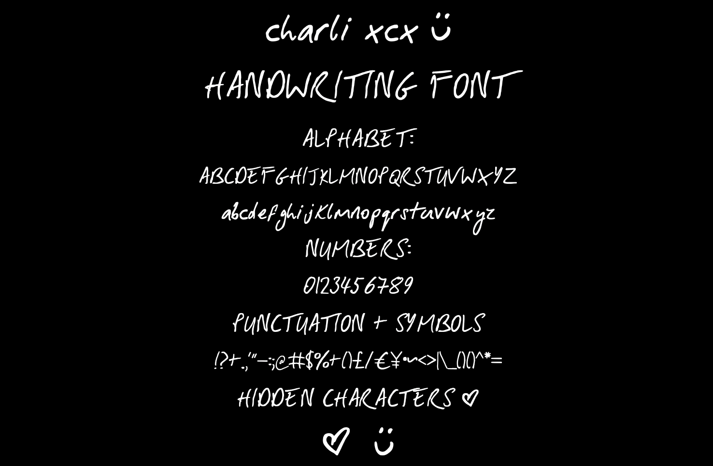

# Charli XCX Handwriting Font 💚

An unofficial fan-made font created from Charli xcx's actual handwriting.

## Download

**[Download the latest version](../../releases/latest)**

Download the font file from the Assets section of the latest release.

## Installation

### macOS
1. Download the `.ttf` font file.
2. Double-click the downloaded file.
3. Click **Install Font** to add it to Font Book.

### Windows
1. Download the `.ttf` font file.
2. Right-click the downloaded file.
3. Select **Install**.

## About

This is an unofficial fan project made for fans of Charli XCX who want to use her handwriting in creative projects.

This project is not affiliated with, endorsed by, or sponsored by Charli xcx or her representatives.

If you download this font you agree that 'I think about it all the time' is Charli xcx's best song.

## 💚 Hidden Characters Guide

The font includes special characters!

| Type this | Character |
|---|---|
| `♥` | Heart |
| `☺` | Smiley face |
| `☻` | Smiley face |

**How to use them:** Copy the character from the table and paste it wherever you're using the font. If your keyboard doesn't have the character, copying and pasting is the easiest way to use it.

## Disclaimer

Charli XCX's name and handwriting may be subject to applicable rights and permissions. Please respect the rights of relevant rights holders when using or redistributing this font.
